# Etsy Payment Tracker SaaS
## Database ERD and Data Model v1.2

**Date:** November 24, 2026  
**Database:** PostgreSQL  
**ORM:** Drizzle ORM  
**Architecture:** Multi-tenant modular monolith

---

# 1. Database Design Principles

1. Every business record belongs to an account (tenant).
2. Monetary values use `NUMERIC(19,4)`, never floating-point types.
3. Every monetary amount has an explicit currency.
4. Finalized financial records are immutable.
5. Corrections use adjustment entries.
6. Every financial movement must be traceable to its source.
7. USD and PKR balances remain separate.
8. Shared expense allocations are analytical, not additional expenses.
9. Customer personal information is never stored.
10. Supplier costs are recognized only when the actual supplier purchase is confirmed.

# 2. Entity Relationship Diagram

```mermaid
erDiagram
    USERS ||--o| ACCOUNTS : owns
    ACCOUNTS ||--o{ ORDERS : owns
    ACCOUNTS ||--o{ PRODUCTS : owns
    ACCOUNTS ||--o{ SUPPLIERS : owns

    ORDERS ||--o{ SHIPMENTS : ships_in
    SHIPMENTS ||--|{ SHIPMENT_EVENTS : records

    ORDERS ||--|{ ORDER_ITEMS : contains
    PRODUCTS ||--o{ ORDER_ITEMS : referenced_by

    SUPPLIERS ||--o{ SUPPLIER_PURCHASES : receives
    SUPPLIER_PURCHASES ||--|{ SUPPLIER_PURCHASE_ITEMS : contains
    ORDER_ITEMS ||--o{ SUPPLIER_PURCHASE_ITEMS : fulfilled_by

    ORDERS ||--o| PAYOUT_ELIGIBILITY : qualifies_for
    PAYOUT_BATCHES ||--|{ PAYOUT_BATCH_ITEMS : groups
    ORDERS ||--o{ PAYOUT_BATCH_ITEMS : included_in

    ETSY_PAYOUTS ||--o{ ETSY_PAYOUT_ALLOCATIONS : allocates
    PAYOUT_BATCH_ITEMS ||--o{ ETSY_PAYOUT_ALLOCATIONS : paid_by

    PAYONEER_TRANSACTIONS ||--o{ PAYONEER_RECONCILIATIONS : reconciles
    ETSY_PAYOUTS ||--o{ PAYONEER_RECONCILIATIONS : matched_to

    PAYONEER_TRANSACTIONS ||--o| BANK_WITHDRAWALS : represents

    ORDERS ||--o{ EXPENSES : incurs
    EXPENSE_CATEGORIES ||--o{ EXPENSES : categorizes
    ORDERS ||--o{ REFUNDS : receives

    SUPPLIER_PURCHASES ||--o{ SUPPLIER_REFUNDS : receives

    JOURNAL_ENTRIES ||--o| JOURNAL_ENTRIES : reversed_by
    FINANCIAL_POSTING_EVENTS ||--|{ FINANCIAL_POSTING_LEGS : declares
    FINANCIAL_POSTING_EVENTS o|--o| JOURNAL_ENTRIES : instructs
    FINANCIAL_ACCOUNTS ||--o{ FINANCIAL_POSTING_LEGS : declares_for
    JOURNAL_ENTRIES ||--|{ JOURNAL_LINES : contains
    FINANCIAL_ACCOUNTS ||--o{ JOURNAL_LINES : posts_to

    EXPENSES ||--o{ EXPENSE_ALLOCATIONS : allocated_as
    ORDERS ||--o{ EXPENSE_ALLOCATIONS : receives

    ACCOUNTS ||--o{ AUDIT_LOGS : audits
    ACCOUNTS ||--o{ IMPORT_JOBS : imports
    ACCOUNTS ||--o{ BACKGROUND_JOBS : schedules
    ACCOUNTS ||--o{ NOTIFICATIONS : receives
```

# 3. Identity and Tenancy

## users
Managed by Better Auth. SQL identity tables are user, session, account, verification; business_accounts is the tenant root. See [version-specific compatibility review](Better_Auth_Compatibility.md).

- id: TEXT, primary key (Better Auth default identity strategy)
- email: TEXT, required and unique
- name: TEXT, required
- created_at: TIMESTAMPTZ
- updated_at: TIMESTAMPTZ

Better Auth owns authentication-specific user, session, and account schemas.

## accounts
Represents one Etsy shop.

- id: UUID, primary key
- owner_user_id: TEXT, FK user, unique (one shop per owner)
- shop_name: VARCHAR
- base_currency: VARCHAR(3), default USD
- timezone: VARCHAR
- created_at: TIMESTAMPTZ
- updated_at: TIMESTAMPTZ

## account_settings
- id
- account_id
- setting_key
- setting_value: JSONB
- updated_at

Stores payout schedule, 14-day eligibility period, expense allocation preferences, and other account settings.

# 4. Products and Orders

## products
- id
- account_id
- name
- sku
- image_url
- default_supplier_id
- default_unit_cost: NUMERIC(19,4)
- currency
- notes
- created_at
- updated_at

Default product cost is informational only. It must not create an expense or affect actual profit.

## orders
- id
- account_id
- etsy_order_id
- order_date
- net_payable_amount: NUMERIC(19,4)
- currency
- status
- delivered_at, nullable
- notes
- created_at
- updated_at

Unique: `(account_id, etsy_order_id)`.

Only Etsy net payable is recorded. Gross customer order value and individual Etsy fee breakdowns are excluded.

## order_items
- id
- account_id
- order_id
- product_id, nullable
- product_name_snapshot
- sku_snapshot
- quantity
- created_at

Snapshots preserve historical product information.

# 5. Suppliers and Purchases

## suppliers
- id
- account_id
- name
- marketplace
- website_url
- notes

Supported marketplaces: eBay, Amazon, AliExpress, and custom suppliers.

## supplier_purchases
- id
- account_id
- supplier_id
- supplier_order_reference
- purchase_url
- purchase_date
- total_amount: NUMERIC(19,4)
- currency
- status
- confirmed_at, nullable
- created_at
- updated_at
- notes

Statuses:
- DRAFT
- CONFIRMED
- CANCELLED
- PARTIALLY_REFUNDED
- REFUNDED

## supplier_purchase_items
- id
- account_id
- supplier_purchase_id
- order_item_id
- quantity
- unit_cost: NUMERIC(19,4)
- total_cost: NUMERIC(19,4)
- currency

Supports multiple supplier purchases for one Etsy order and purchases covering multiple order items.

## Supplier Cost Recognition Rule

- Etsy order creation: no supplier expense.
- Product added to order: no supplier expense.
- Draft supplier purchase: no supplier expense.
- Confirmed supplier purchase: recognize actual cost.
- Cancelled unpaid purchase: no expense.
- Supplier refund: record a separate adjustment.

Confirmation must atomically validate the purchase, post its financial journal entry, and prevent duplicate postings.

A confirmed purchase cannot simply be edited. Corrections require adjustment entries.

# 6. Delivery and Etsy Payout Eligibility

## payout_eligibility
- id
- account_id
- order_id
- delivered_at
- eligibility_date
- status
- evaluated_at

Unique: `(account_id, order_id)`.

Default eligibility: 14 elapsed days after successful delivery.

## payout_batches
- id
- account_id
- expected_payout_date
- status
- expected_total_amount
- currency
- created_at

Groups eligible orders into expected Monday payouts.

## payout_batch_items
- id
- account_id
- payout_batch_id
- order_id
- expected_amount
- currency

An order must not be included twice in active batches.

# 7. Actual Etsy Payouts

## etsy_payouts
- id
- account_id
- external_reference
- payout_date
- actual_amount
- currency
- status
- notes
- created_at

## etsy_payout_allocations
- id
- account_id
- etsy_payout_id
- payout_batch_item_id
- allocated_amount
- currency

Supports partial payouts, adjusted payouts, and multiple actual payouts covering one expected item.

Expected and actual payouts remain separate.

# 8. Payoneer

## payoneer_transactions
- id
- account_id
- external_transaction_id, nullable
- transaction_date
- transaction_type
- amount
- currency
- fee_amount
- fee_currency
- description
- import_job_id, nullable
- created_at

Transaction types:
- DEPOSIT
- WITHDRAWAL
- FEE
- ADJUSTMENT
- OTHER

Use unique external IDs when available. Manual transactions require duplicate review.

## payoneer_reconciliations
- id
- account_id
- payoneer_transaction_id
- etsy_payout_id
- allocated_amount
- currency
- status
- confirmed_at

Supports one deposit matching multiple Etsy payouts, partial matches, and unmatched balances.

# 9. Bank Withdrawals

## bank_withdrawals
- id
- account_id
- payoneer_transaction_id
- withdrawal_date
- usd_amount
- actual_pkr_received
- actual_exchange_rate
- fee_amount
- fee_currency
- bank_reference
- notes

A withdrawal is an asset transfer, not an expense. Only its associated fees and actual FX gains/losses affect profitability.

# 10. Expenses and Refunds

## expense_categories
- id
- account_id
- name
- category_type
- is_active

## expenses
- id
- account_id
- category_id
- order_id, nullable
- expense_type
- amount
- currency
- expense_date
- description
- source_reference
- status
- created_at

Expense types:
- DIRECT
- SHARED

Categories include advertising, subscriptions, shipping, Payoneer fees, refund-related costs, miscellaneous, and custom categories.

Confirmed supplier purchases are not duplicated in this table. Their costs originate from supplier purchase records.

## refunds
- id
- account_id
- order_id
- refund_date
- refund_amount
- currency
- refund_type
- notes

Supports full and partial Etsy refunds.

## supplier_refunds
- id
- account_id
- supplier_purchase_id
- refund_date
- refund_amount
- currency
- external_reference
- notes

Supplier refunds are separate from Etsy customer refunds.

## refund_adjustments
- id
- account_id
- refund_id
- adjustment_type
- amount
- currency
- description
- created_at

# 11. Financial Ledger

## financial_accounts
- id
- account_id
- name
- account_type
- account_role: validated asset/revenue/cost/refund identity; defaults UNCLASSIFIED for explicit classification
- currency
- is_active

Account examples:
- Etsy receivable.
- Etsy payout clearing.
- Payoneer USD.
- Pakistani bank PKR.
- Supplier costs.
- Direct expenses.
- Shared expenses.
- Revenue.
- Refunds.
- FX gains and losses.

## journal_entries
- id
- account_id
- source_type
- source_id
- source_event: stable event name
- currency
- idempotency_key: tenant-unique stable event key
- posting_event_id, nullable: tenant/currency FK to explicit instructions
- reversal_of_entry_id, nullable: tenant/currency self FK, unique per original
- transaction_date
- description
- status
- created_at
- finalized_at

## journal_lines
- id
- account_id
- journal_entry_id
- financial_account_id
- debit_amount
- credit_amount
- currency

Rules:
- Every finalized entry balances per currency.
- A line cannot contain both a positive debit and positive credit.
- Finalized entries cannot be edited or deleted.
- Corrections require new entries.
- Posting must be transactional and idempotent.

# 12. Expense Allocation

## expense_allocations
- id
- account_id
- expense_id
- order_id
- reporting_period_start
- reporting_period_end
- allocation_method
- allocated_amount
- currency
- calculation_snapshot: JSONB
- created_at

Methods:
- PROPORTIONAL
- EQUAL
- MANUAL
- CUSTOM

Default: proportional allocation based on each order's share of Etsy net payable during the reporting period.

Allocations are analytical only and never create additional expenses.

# 13. Exchange Rates

## exchange_rates
- id
- account_id: NOT NULL tenant FK (strict ownership supersedes global rates)
- base_currency
- quote_currency
- rate
- rate_date
- source
- is_manual
- created_at

Keep estimated reference rates separate from actual bank conversion rates.

Actual PKR received and actual conversion rate take precedence in realized reporting.

# 14. Platform Operations

## audit_logs
- id
- account_id
- user_id
- entity_type
- entity_id
- action
- before_data: JSONB
- after_data: JSONB
- created_at

## import_jobs
- id
- account_id
- import_type
- filename
- status
- total_rows
- successful_rows
- failed_rows
- created_at
- completed_at

## import_rows
- id
- account_id
- import_job_id
- row_number
- raw_data: JSONB
- normalized_data: JSONB
- status
- error_message

## background_jobs
- id
- account_id: NOT NULL tenant FK (dispatch jobs per tenant)
- job_type
- payload: JSONB
- status
- scheduled_at
- attempts
- idempotency_key
- locked_at
- last_error
- created_at
- completed_at

## notifications
- id
- account_id
- notification_type
- title
- message
- reference_type
- reference_id
- is_read
- created_at

# 15. Financial Calculation Rules

## Actual Direct Order Profit

Etsy Net Payable
- Confirmed Supplier Purchase Costs
- Direct Order Expenses
- Refund Adjustments

## Business Profit

Total Direct Order Profit
- Shared Business Expenses

## Business-Adjusted Order Profit

Direct Order Profit
- Analytical Allocation of Shared Expenses

Shared expenses are deducted once at business level. Allocation must never double-count them.

Maintain separate reporting for:
- Expected payouts.
- Actual payouts.
- Direct order profit.
- Business-adjusted profit.
- Realized profit.
- Cash profit.

## Reporting Perspectives

**Order-date perspective:** Attribute order revenue and relevant costs to the order date.

**Cash-date perspective:** Attribute actual receipts and payments to their actual transaction dates.

# 16. Database Constraints and Indexes

- Every business table includes `account_id`.
- Use composite foreign keys to prevent cross-tenant relationships.
- Unique `(account_id, etsy_order_id)`.
- Unique external transaction references where available.
- Index account ID, transaction dates, statuses, and reconciliation references.
- Use `NUMERIC(19,4)` for monetary values.
- Use `TIMESTAMPTZ` for event timestamps.
- Use explicit currency codes.
- Use soft deletion only for ordinary editable records.
- Never hard-delete finalized financial transactions.
- Enforce balanced journal entries through transactional posting logic and database validation where practical.

# 17. Implementation Notes

This is a logical database design, not final migration SQL.

Before implementation:
1. Confirm Better Auth's generated schema.
2. Define PostgreSQL enums and allowed status transitions.
3. Define currency rounding rules.
4. Implement transactional ledger posting.
5. Add tenant-safe composite foreign keys.
6. Add indexes and uniqueness constraints.
7. Test supplier purchase confirmation and refund scenarios.
8. Test payout and reconciliation edge cases.
9. Verify idempotency for every financial posting.

**Design objective:** Maintain a complete, auditable financial history while keeping the database practical for a small SaaS operating on free infrastructure.

# 18. Financial hardening and manual shipments (v1.2)

The detailed accounting contract is in [Financial Posting Rules](Financial_Posting_Rules.md). Standard source movements enforce source amounts, account roles/types and currencies. Finalized and legacy reversed entries remain immutable. A reversal is a new FINALIZED entry referencing the original with exactly opposite lines; the original status never changes. Unique original references prevent duplicate reversals; self-references and reversal chains are forbidden. Effective reversed state is derived from the referencing finalized reversal.

## financial_posting_events / financial_posting_legs

Explicit instructions are mandatory for refund adjustments, Payoneer ADJUSTMENT/OTHER, opening balances and generic corrections. Headers contain tenant, event_key, source_type/id/event, source_amount, currency, explicit amount_basis and optional control_financial_account_id. Event identity and source identity are unique within a tenant. Legs contain tenant, event FK, financial account FK, currency and exact nonzero debit or credit amounts. Composite currency FKs enforce both ownership and denomination. NET_DEBIT/NET_CREDIT support signed and compound source movements; TOTAL_DEBITS is an explicitly selected basis. Journal lines must exactly match the declared multiset. Finalized instructions are immutable.

## shipments / shipment_events

Shipments store tenant, order FK, carrier, tracking_number/URL, shipment_status, shipped/estimated_delivery/delivered timestamps, notes and creation/update timestamps. Multiple shipments per order are supported. Tenant/id is UNIQUE, and tenant/order, tracking and status/date indexes support manual lookup.

Shipment events store tenant, shipment FK, generated event_sequence, event_type/date, description, optional location and created_at. Tenant/shipment/sequence and tenant/shipment/date indexes preserve ordered history. Restrictive FKs and append-only event guards prevent deletion of operational history. Events project shipment status/timestamps with validated transitions; manual metadata remains editable and audited. See [Shipment Tracking](Shipment_Tracking.md) for transition rules. No tracking API or customer address/identity fields are added. Shipment events do not mutate order delivery, payout eligibility or financial entries.

## Implementation status

Migrations 0000 and 0001 are unchanged. Forward migrations 0002–0006 add these structures and guards. No database migrations were applied during this task. Database runtime/concurrency validation and full session/RLS authorization remain required; referential integrity is not SELECT access control. See [local integration test instructions](../tests/README.md).
